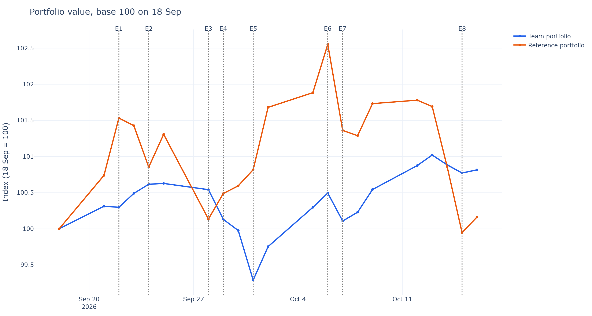

# Portfolio Tracker: Team vs Reference (TSM Trading Game 2026)

Daily valuation and risk analysis of two buy-and-hold portfolios (€100,000 notional each,
18 Sep → 16 Oct 2026), built for the M1 Finance Trading Game at Toulouse School of Management.

## Result
| Portfolio | 18 Sep | 16 Oct | P&L | Return | Volatility (ann.) | Max drawdown |
|---|---:|---:|---:|---:|---:|---:|
| **Team** | €100,000.00 | €100,815.70 | **+€815.70** | **+0.82%** | 4.84% | −1.33% |
| Reference | €100,000.00 | €100,161.75 | +€161.75 | +0.16% | 9.89% | −2.54% |

## What it does
- Pulls prices (Yahoo Finance), EUR/USD and €STR (ECB API); adds manually sourced bond and fund prices
- Prices bonds on a dirty basis (clean + accrued interest, ACT/ACT and 30/360) and a NEU CP from its yield
- Converts USD assets to EUR and splits P&L into price, carry, dividend and currency effects
- Computes volatility, Sharpe, max drawdown, VaR, tracking error, information ratio, beta,
  risk contributions and diversification ratio
- Updates itself every weekday with GitHub Actions; results shown in a Streamlit dashboard

## Methodology
- Buy-and-hold: units fixed at the 18 Sep close; weights drift; no rebalancing, no costs
- Bonds valued at dirty price; no coupon paid during the period
- Dividends credited as cash on the ex-date
- Risk-free rate: €STR; annualisation with 252 trading days
- Limits: ~20 daily observations, so risk statistics are indicative only

## Run it
    pip install -r requirements.txt
    python -m tracker.update     # download and value
    python -m tracker.report     # export charts and tables
    streamlit run app.py         # dashboard
    
<!-- Author: Nguyễn Ngọc Nhi · M1 Finance, TSM · <LinkedIn link> -->