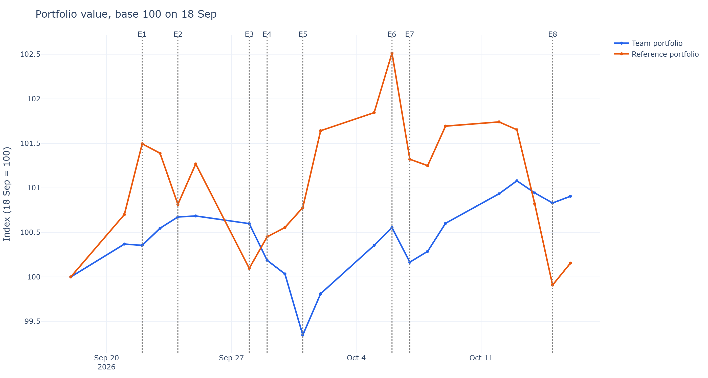

# Portfolio Tracker: Team vs Reference (TSM Trading Game 2026)

Daily valuation and risk analysis of two buy-and-hold portfolios (€100,000 notional each,
18 Sep → 16 Oct 2026), built for the M1 Finance Trading Game at Toulouse School of Management.

## Result
<!-- RESULTS:START -->
| Portfolio | 18 Sep | 16 Oct | P&L | Return (EUR) | Return (local ccy) | Volatility (ann.) | Max drawdown | Sharpe |
|---|---:|---:|---:|---:|---:|---:|---:|---:|
| **Team** | €100,000.00 | €100,905.54 | +905.54 € | +0.91% | +0.35% | 4.88% | −1.33% | 1.85 |
| **Reference** | €100,000.00 | €100,154.89 | +154.89 € | +0.15% | −0.28% | 9.97% | −2.54% | −0.00 |

Team minus reference: **+750.66 €**. Local-currency return = P&L excluding the EUR/USD effect.

### Where the P&L came from (€)

| Position | 18 Sep | 16 Oct | P&L | Return | Price | Carry | Dividends | FX |
|---|---:|---:|---:|---:|---:|---:|---:|---:|
| **Team** | | | | | | | | |
| iShares MSCI World EUR Hedged (Acc) | 25,000.00 | 25,220.23 | +220.23 | +0.88% | +220.23 | – | – | – |
| TotalEnergies SE | 15,000.00 | 15,433.06 | +433.06 | +2.89% | +262.86 | – | +170.20 | – |
| iShares STOXX Europe 600 Banks (DE) | 10,000.00 | 9,461.70 | −538.30 | −5.38% | −588.51 | – | +50.22 | – |
| iShares $ Treasury Bond 0-1yr | 25,000.00 | 25,633.32 | +633.32 | +2.53% | +82.09 | – | – | +551.23 |
| Schatz 2.70% 13/09/2028 | 25,000.00 | 25,157.24 | +157.24 | +0.63% | +104.89 | +52.35 | – | – |
| **Total team** | **100,000.00** | **100,905.54** | **+905.54** | **+0.91%** | **+81.55** | **+52.35** | **+220.41** | **+551.23** |
| **Reference** | | | | | | | | |
| JPM US Technology A (acc) EUR Hedged | 25,000.00 | 24,689.57 | −310.43 | −1.24% | −310.43 | – | – | – |
| BNP Paribas Funds Aqua Classic C | 25,000.00 | 25,818.29 | +818.29 | +3.27% | +818.29 | – | – | – |
| Barclays 9.625% Perp (call 15/12/2029) | 20,000.00 | 20,256.49 | +256.49 | +1.28% | −315.75 | +136.63 | – | +435.60 |
| NEU CP Renault 16/12/2026 | 15,000.00 | 15,034.59 | +34.59 | +0.23% | +34.59 | – | – | – |
| iShares Physical Gold EUR Hedged ETC | 15,000.00 | 14,355.95 | −644.05 | −4.29% | −644.05 | – | – | – |
| **Total reference** | **100,000.00** | **100,154.89** | **+154.89** | **+0.15%** | **−417.35** | **+136.63** | **–** | **+435.60** |

Price = change in clean price; Carry = accrued interest on bonds; FX = effect of EUR/USD on USD assets. The NEU CP gain is its yield accruing, shown under Price.
<!-- RESULTS:END -->

## What it does
- Pulls prices (Yahoo Finance), EUR/USD and €STR (ECB API); adds manually sourced bond and fund prices
- Prices bonds on a dirty basis (clean + accrued interest, ACT/ACT and 30/360) and a NEU CP from its yield
- Converts USD assets to EUR and splits P&L into price, carry, dividend and currency effects
- Computes volatility, Sharpe, max drawdown, VaR, tracking error, information ratio, beta,
  risk contributions and diversification ratio
- Updates itself every weekday with GitHub Actions; results shown in a Streamlit dashboard

## Methodology
- Buy-and-hold: units fixed at the 18 Sep close; weights drift; no rebalancing, no costs
- Bonds valued at dirty price; no coupon paid during the period
- Dividends credited as cash on the ex-date
- Risk-free rate: €STR; annualisation with 252 trading days
- Limits: ~20 daily observations, so risk statistics are indicative only

## Run it
    pip install -r requirements.txt
    python -m tracker.update     # download and value
    python -m tracker.report     # export charts and tables
    streamlit run app.py         # dashboard
    
<!-- Author: Nguyễn Ngọc Nhi · M1 Finance, TSM · <LinkedIn link> -->